# OpenRemote

Use your phone as a touchpad, keyboard and media remote for your Windows PC, with no app to install on the phone.
One small Rust program on the PC serves a touch-friendly web app over your Wi-Fi.

<p align="center">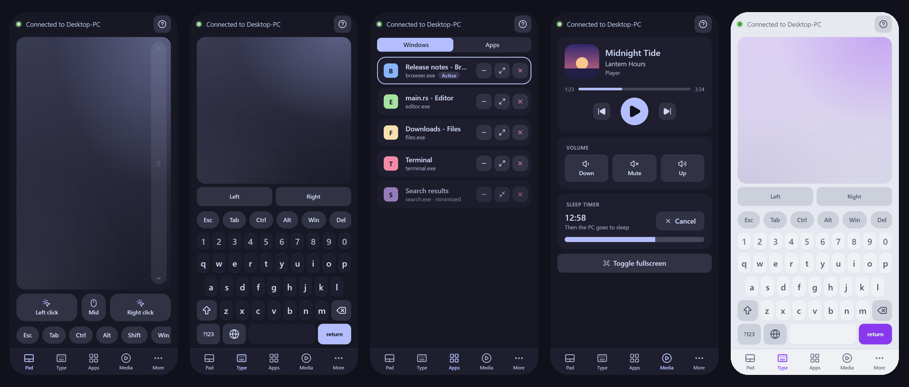</p>

## Features

**Control**
- **Touchpad** with tap to click, two-finger tap to right-click, two-finger scroll, tap-then-hold to drag, a scroll strip, and labeled Left / Mid / Right buttons that you can hold.
- **Keyboard**: on-screen QWERTY with number row, symbols, shift and caps, key pop-ups and hold-to-repeat; sticky Ctrl/Alt/Shift/Win for shortcuts; or your phone's own keyboard (emoji, other languages, swipe typing).
- **Special keys**: Fn row, numpad, navigation block, arrows.
- **Media remote** that follows what is playing: title, artist, cover art, a progress bar and a play/pause button that switches with the player (any app that reports to Windows: browsers, Spotify, VLC and more). Also next/previous, volume (hold to repeat), mute and fullscreen. A **sleep timer** (see below) puts the PC to sleep after a set time or when the episode ends.

**Windows**
- **App switcher**: live list of open windows with real icons; focus, minimize, maximize, restore or close each one. The active window is highlighted.
- **App launcher**: every Start Menu app with its icon, A-Z sections, search, and a Recent row.
- **Browser controls**: back, forward, tabs, zoom, find, and open a link on the PC.
- **Clipboard** for text and images, both ways: send text, a photo or a pasted image to the PC; get the PC's text or image on the phone (long-press an image to Copy or Save). Copies are confirmed, and a busy Windows clipboard is retried. Sending images works when the page is opened from the PC's own address.
- **Power**: lock, sleep, hibernate, sign out, restart, shut down (two taps to confirm, except Lock).

**App and desktop**
- **Input on UAC prompts, administrator windows and the lock screen**, with an optional SYSTEM helper service you install on purpose (off by default, see Security).
- **Tray icon and dashboard** (see below); the release build has no console window.
- **Installable web app (PWA)** with a manifest, icons and an offline shell.
- **Catppuccin theming**: Latte, Frappe, Macchiato, Mocha or Auto, with six accent colors.
- **Polished motion**: short, subtle animations, switched off by the phone's "reduce motion" setting.
- **One PC per page**: the page connects straight back to the PC that served it. Saving and switching between several PCs is planned (see the roadmap).
- **Landscape layout** with a side navigation rail.
- **Pairing**: a phone must pair once (type the 6-digit code shown on the PC, scan its QR, or open its link) before it can control anything. Pairing is on by default, each phone has its own key, and any phone can be revoked from the PC.

## Screenshots

<table>
  <tr>
    <td align="center">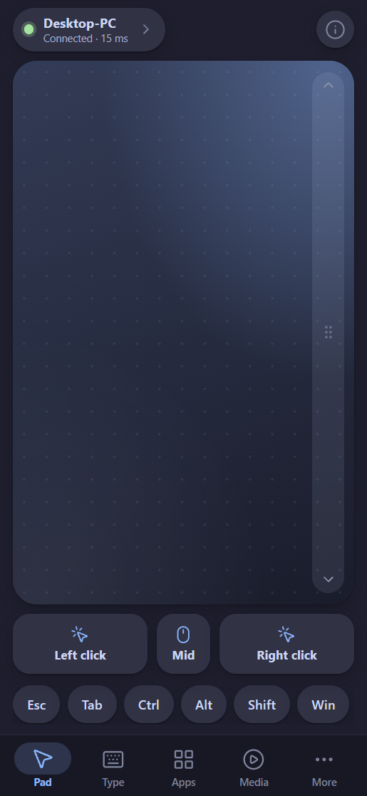<br><sub>Pad</sub></td>
    <td align="center">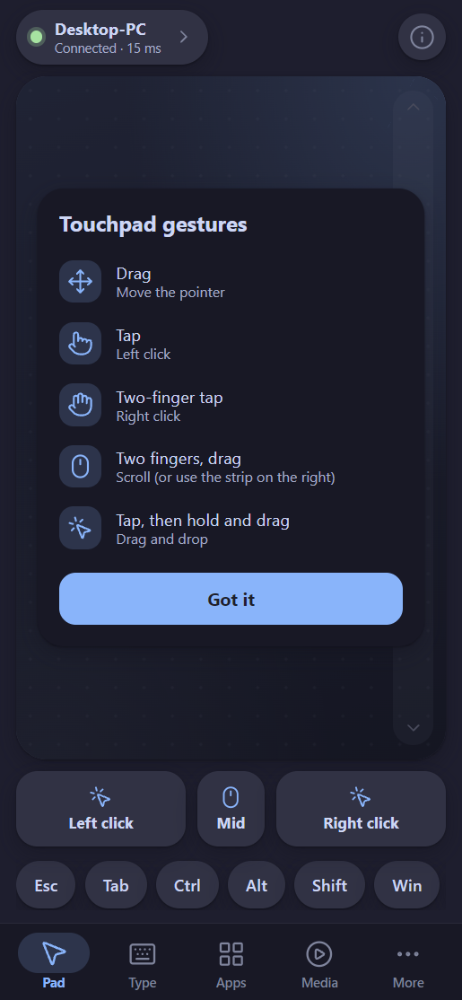<br><sub>First-run gestures</sub></td>
    <td align="center">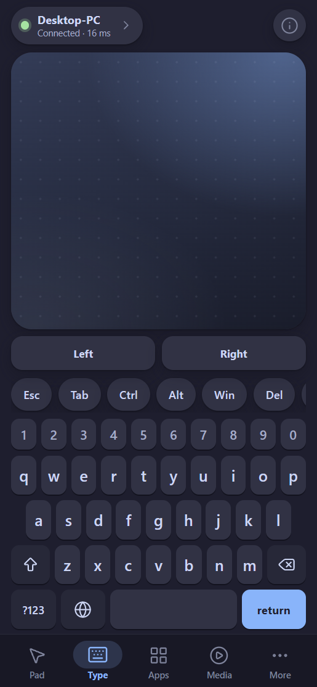<br><sub>Type</sub></td>
    <td align="center">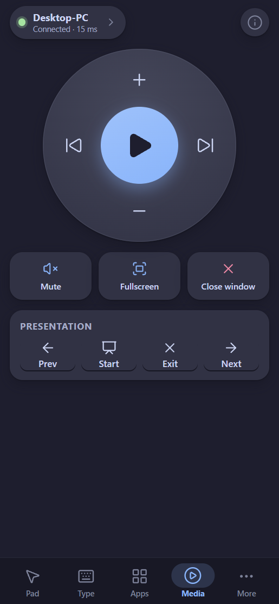<br><sub>Media</sub></td>
  </tr>
  <tr>
    <td align="center">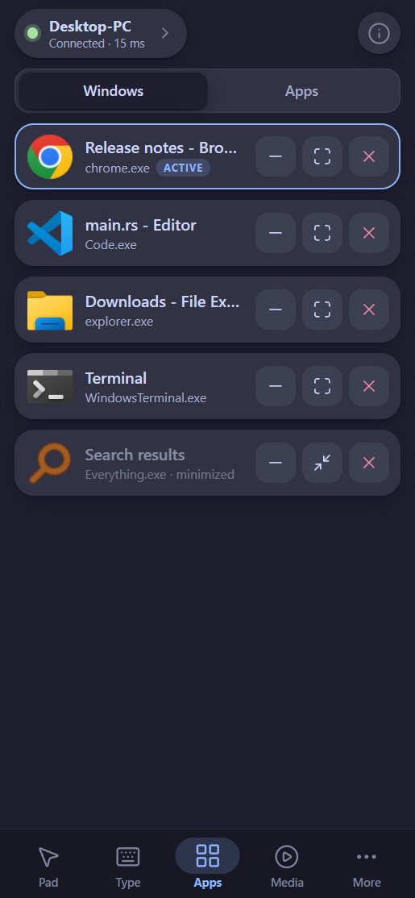<br><sub>Open windows</sub></td>
    <td align="center">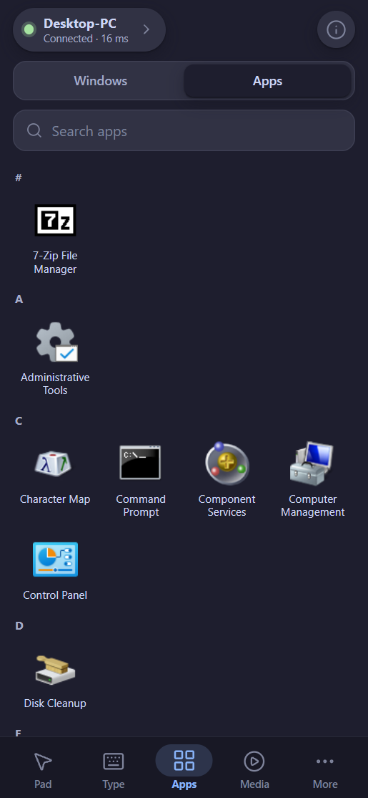<br><sub>App launcher</sub></td>
    <td align="center">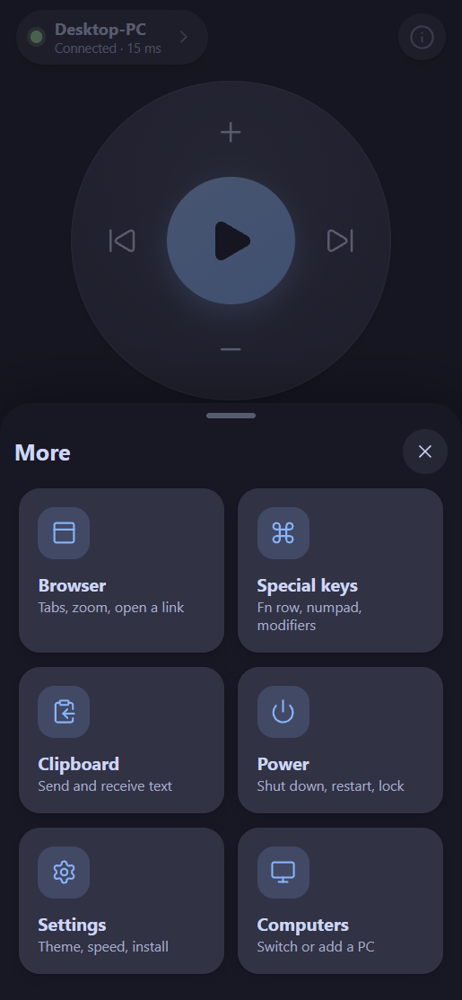<br><sub>More sheet</sub></td>
    <td align="center">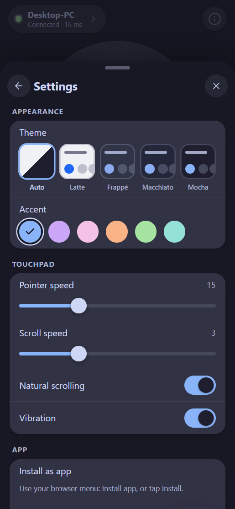<br><sub>Settings</sub></td>
  </tr>
  <tr>
    <td align="center">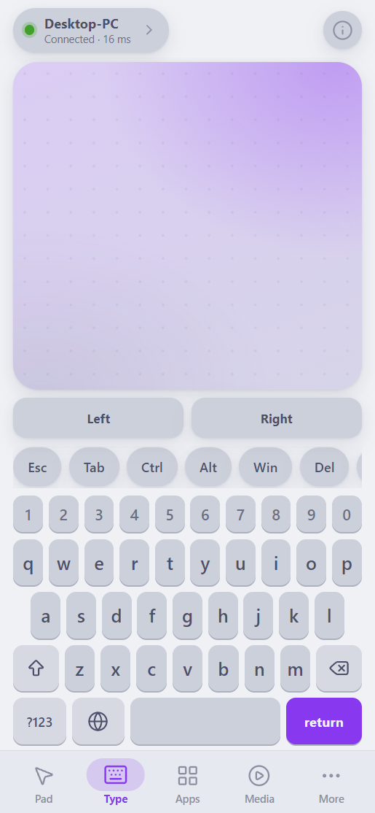<br><sub>Latte + mauve</sub></td>
    <td align="center">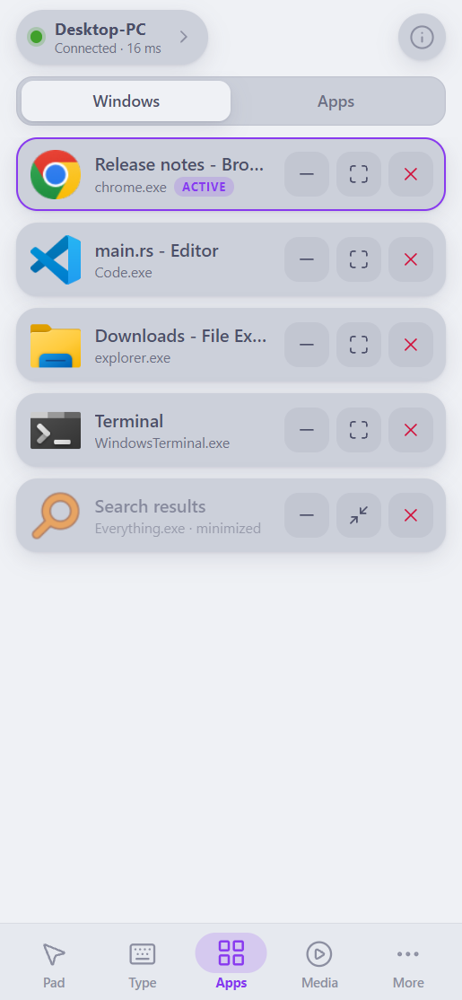<br><sub>Latte windows</sub></td>
    <td></td>
    <td></td>
  </tr>
</table>

Screenshots use a mock connection with fictional window titles. The icons are real extractions from a Windows machine.

## Quick start

Requirements: Windows 10/11 and a [Rust](https://rustup.rs) toolchain.

```powershell
cargo run --release
```

1. A tray icon appears. Open the dashboard from it (or `http://127.0.0.1:1990/admin` on the PC) and choose *Add a device*: it shows a 6-digit code, a QR and a link. The dashboard also lists paired devices, renames and removes them, and can pause pairing.
2. On the phone, on the same Wi-Fi, open `http://<pc-ip>:1990/` and type the code (no camera needed), or scan the QR code, or open the link. This is needed once per phone; after that the phone stays paired until you remove it.
3. Allow the program through Windows Firewall (Private networks) if prompted.
4. Optional: *Add to Home Screen* for a full-screen app (see below).

Options:

| Flag | Meaning |
|---|---|
| `--port N` | listen port (default 1990, saved) |
| `--hostname NAME` | name shown on the phone (default: computer name) |
| `--pairing` / `--no-pairing` | require phones to pair (the default) or not (saved) |
| `--autostart` / `--no-autostart` | start with Windows for this user (also a toggle in the tray menu) |
| `--smoothing MS` | pointer smoothing time constant (default 15; 0 turns it off). Higher glides more but adds delay |
| `--no-tray` | no tray icon; run in the foreground |
| `--install-helper --yes` | install the SYSTEM input helper (needs administrator approval on the PC) |
| `--uninstall-helper` | remove the helper |
| `--helper-status` | say whether the helper is running |
| `-v` | log ignored messages |

Settings live in `%APPDATA%\openremote\settings.json`.

### Install as an app

- **iPhone / iPad**: Safari, Share, *Add to Home Screen*. Works over plain HTTP.
- **Android**: Chrome only does a full install over HTTPS or localhost; over plain HTTP you get a shortcut. For the full install, open `chrome://flags`, enable *Insecure origins treated as secure*, add `http://<pc-ip>:1990`, relaunch Chrome, then *Install app*.

## Tray and dashboard

The tray icon (near the clock) opens the dashboard and has Pair a phone, Copy phone link, Pause pairing, Start with Windows, Open log folder, Restart and Exit. The dashboard is at `http://127.0.0.1:1990/admin` and opens only on the PC itself. It lists paired devices, adds a device (with an optional name), renames and removes devices, and pauses pairing. Only one copy runs per port: starting it again opens the dashboard of the running one. Start with Windows launches it quietly (no dashboard). Closing the console or launcher window does not stop it; use Exit in the tray.

## Pairing

A phone pairs once, then stays paired until it is removed. The dashboard shows one offer with three ways in: a 6-digit code to type (no camera needed), a QR code, and a link. An offer lasts 5 minutes and works once. Five wrong codes in a row pause pairing for 5 minutes. Each phone gets its own key; only a hash of it is kept on the PC. Pause pairing stops new phones without disconnecting the paired ones.

## Sleep timer

Choose 10 sec (a test), 15, 30 or 45 min, 1 or 2 hours, or the end of the episode. The PC keeps the countdown, so it still sleeps if the phone disconnects, and every connected phone shows the same timer. An end-of-episode timer waits while the episode is still playing (paused, for example). It can be cancelled at any time.

## Architecture

```
 Phone (any modern browser)                       Windows PC (one process: openremote.exe)
+---------------------------+                    +------------------------------------------------+
|  Web app (PWA)            |   HTTP  GET /      |  web.rs        axum + tokio                    |
|  - pages: Pad/Type/Apps/  | <----------------> |    /            single-page app (embedded)     |
|    Media + More sheet     |   WebSocket /ws    |    /ws          JSON control channel           |
|  - gesture + key logic    | <----------------> |    /icon/<key>  PNG icons                      |
|  - Catppuccin + motion    |   HTTP  /icon/..   |    /admin       phone links (loopback)         |
+---------------------------+                    |        |                                       |
                                                 |        v                                       |
                                                 |  command.rs   Msg -> Dispatcher -> Injector    |
                                                 |        |        (validation, clamping,         |
                                                 |        |         key names, URL allow-list)    |
                                                 |        v                                       |
                                                 |  input.rs / winapps.rs   Windows backend       |
                                                 |    SendInput, EnumWindows, ShowWindow,         |
                                                 |    ShellExecute, icon extraction, clipboard,   |
                                                 |    power commands                              |
                                                 |                                                |
                                                 |  main thread: shell.rs  tray icon + Win32 loop |
                                                 +------------------------------------------------+
```

**Data flow.** The phone sends small JSON messages (`move`, `btn`, `key`, `text`, `win.list`, ...) over one WebSocket. `web.rs` parses them into a typed `Msg`, and the `Dispatcher` in `command.rs` validates and clamps them, then calls the platform `Injector`. Replies (window lists, clipboard text, pong) go back on the same socket. Window and app icons are fetched over plain HTTP by key.

| Part | Role |
|---|---|
| `src/main.rs` | CLI, settings, builds the runtime; server on a worker thread, tray on the main thread |
| `src/web.rs` | HTTP routes, WebSocket loop, manifest, icon route, Host/Origin and pairing checks, loopback-only admin page |
| `src/pairing.rs` | One-time pairing offers, paired phones (key hashes), lockout after wrong guesses |
| `src/command.rs` | `Msg` types, `Injector` trait, `Dispatcher`, key-name table, URL and id validation |
| `src/input.rs` | Windows `Injector`: `SendInput`, power, clipboard, open URL (stub on other OSes) |
| `src/media.rs` | Now-playing info and cover art from the Windows system media session |
| `src/uac.rs` | Optional SYSTEM input helper: wire format, helper process, Windows service, install and uninstall |
| `src/winapps.rs` | Window enumeration and actions, Start Menu scan, icon extraction to PNG |
| `src/shell.rs` | Tray icon and message loop, console attach, error dialog |
| `src/image.rs` | PNG validation (dimensions before decoding), RGBA conversion for clipboard images |
| `src/settings.rs` | Persistent port |
| `build.rs` + `assets/ui/` | Assembles the web app into one self-contained page at compile time |

**Design decisions**
- **One port, one binary.** No installer, runtime or phone app. The page is embedded in the executable and works offline on the LAN.
- **Frontend is replaceable.** The WebSocket protocol is the contract, so a native app could be built on the same server.
- **Clients never name files or handles.** The server issues opaque 16-hex keys for apps and icons; window actions only apply to windows the server would list.
- **Testable core.** All Win32 calls sit behind the `Injector` trait, so protocol and validation are tested with a mock and a real WebSocket.
- **No UDP, no custom crypto.** A LAN WebSocket with `TCP_NODELAY` is fast enough; the frontend batches pointer moves to one per frame.

## Protocol

JSON text frames on `GET /ws`.

```
{"t":"move","dx":3,"dy":-2}                 pixels, relative
{"t":"btn","b":"left|right|middle","s":"down|up|click|dbl"}
{"t":"scroll","dx":0,"dy":120}              120 = one notch; positive dy scrolls down
{"t":"key","k":"ctrl+shift+t","s":"down|up"}  s omitted = press; names in command.rs
{"t":"text","v":"hello"}                    typed as unicode
{"t":"power","a":"lock|sleep|hibernate|logoff|restart|shutdown"}
{"t":"open","url":"https://..."}            http(s) only, opened in the default browser
{"t":"clip.set","text":"..."}               replace PC clipboard text (max 256 KB) -> {"t":"clip.ack","ok":true|false}
{"t":"clip.get"}                            -> {"t":"clip","text":"...","image":{"w":..,"h":..}|null}
{"t":"media.get"}                           -> {"t":"media","state":"playing|paused|stopped|none","title":"..","artist":"..","app":"..","pos":s,"dur":s,"art":bool}
{"t":"sleep.set","secs":s}                    -> {"t":"sleep","on":true,"left":s,"total":s,"episode":bool}  (or {"on":false,"err":"bad-time"}); secs is capped at 12 h
{"t":"sleep.set","episode":true}                -> same; ends when the playing item ends ({"on":false,"err":"no-episode"} if its length is unknown)
{"t":"sleep.cancel"} / {"t":"sleep.get"}        -> {"t":"sleep","on":false} / the current timer
{"t":"win.list"}                            -> {"t":"win.list","items":[{id,title,exe,icon,minimized,maximized,foreground}]}
{"t":"win.act","id":123,"a":"focus|min|max|restore|close"}
{"t":"app.list"}                            -> {"t":"app.list","items":[{id,name,icon}]}
{"t":"app.launch","id":"<id from app.list>"}
{"t":"ping"}                                -> {"t":"pong"}
```

The server greets with `{"t":"hello","host":...,"v":...}`. Unknown or malformed messages are ignored. `tests/fixtures/protocol.json` is the machine-checked list of what parses and what is refused: `tests/protocol.rs` checks it against the server and `tests/frontend_protocol.test.mjs` checks that the page sends nothing else.

Plain HTTP routes next to the socket:
- `GET /icon/<key>.png`: window and app icons. Keys are issued by the server in `win.list` / `app.list`, so clients can only fetch or launch things the server itself found.
- `GET /clip/image.png`: the PC clipboard image as a PNG.
- `GET /media/art`: cover image of the track that is playing (PNG or JPEG), 404 when there is none.
- `GET /pair/status`: `{required, paired, device}` for the caller. `POST /pair` (`{code}` or `{secret}`, plus `name`): pair and receive the key cookie. `POST /pair/forget`: a phone removes itself. `POST /admin/revoke` (loopback only): remove a phone.
- `POST /clip/image`: put an uploaded PNG on the PC clipboard (`Content-Type: image/png`, up to 32 MB, at most 8192 px a side and 36 megapixels). The page converts photos to PNG on the phone first.

## Input on UAC prompts and the lock screen

Windows does not let a normal program send input to administrator windows or to the secure desktop (the UAC
prompt, the lock screen). To make the phone's mouse and keyboard work there, OpenRemote has an optional helper:

```
openremote --install-helper --yes     # asks for administrator approval on the PC, installs the service
openremote --helper-status            # is it running?
openremote --uninstall-helper         # removes it again
```

How it works: the command copies `openremote.exe` to `C:\Program Files\OpenRemote\` (only administrators can
write there) and registers a Windows service that runs as SYSTEM. The service keeps one helper process alive
in the signed-in user's session with a SYSTEM token. The helper listens on a local named pipe that only SYSTEM
and the signed-in user can open (remote clients are refused) and sends the input to whichever desktop is
currently getting input. The normal app forwards mouse and keyboard events to the helper when it is there and
falls back to plain `SendInput` when it is not. Settings > App on the phone shows whether it is active.

Read before turning it on:

- Any program running as you can use the helper to send input, including to a UAC prompt.
- Pairing protects it from strangers on your network, but a phone you paired can click through a UAC prompt on this PC. Pair only phones you trust, and revoke lost ones.
- Use it only on a network you fully trust, and remove it (`--uninstall-helper`) when you do not need it.
- Text typed from the phone uses the keyboard layout of the signed-in user, also on the secure desktop.

## Security

- **Plain HTTP.** Nothing on the network is encrypted, so someone who can watch your Wi-Fi traffic can read what you type and could steal a paired phone's key cookie. Pairing keeps strangers out, it does not hide traffic. HTTPS is on the roadmap. With `--no-pairing`, anyone who can reach port 1990 can control the PC (type keys, shut down, read or write the clipboard).
- **Pairing.** The PC shows a one-time offer (a 6-digit code, a QR and a link from one offer, valid 5 minutes, usable once). A phone that proves it has the offer gets a random 256-bit key as an `HttpOnly`, `SameSite=Strict` cookie, so the key never appears in a URL and page scripts cannot read it. The PC stores only a SHA-256 hash of each key. Five wrong guesses in a row pause pairing for 5 minutes and burn the offer. Revoking a phone cuts its open connection within a few seconds. The PC itself (loopback) never needs to pair. Everything except the page, the manifest, the icons and the pairing routes needs a paired phone.
- `/admin` answers only loopback requests with a loopback `Host` header.
- **Other websites cannot reach the app.** Every request must use an address a person would type (an IP address, `localhost`, this PC's name or a `.local` name), which blocks DNS rebinding. A request that carries an `Origin` (every browser WebSocket and cross-site fetch does) must come from the page the app itself serves. Scripts and tools without an `Origin` still work.
- Input is clamped (move, scroll, text length); `open` accepts only `http`/`https` URLs without whitespace; app launches and icons only by server-issued keys.
- Image uploads are validated before use: the PNG signature and dimensions are checked before any pixel is decoded, and only `image/png` bodies are accepted. A website cannot send that to the PC without a CORS preflight, which the server never grants.
- Window titles are sent to connected phones; the web app renders them as text, never HTML.

## Project layout

```
src/            Rust server (see Architecture)
assets/ui/      Web app sources: head.html, body.html, app.js, app.src.css; kit/ (cuppa-ui kit); generated app.css and icons.html
assets/         sw.js (service worker), PWA and tray icons
build.rs        Joins assets/ui/* into one page (no Node needed)
package.json    Build-time only: `npm run build` regenerates app.css and the icon sprite
tests/ws.rs     End-to-end tests: real server + WebSocket client + mock injector
tools/          gen_icons.py (app icons)
docs/           theme-config.md (Catppuccin role mapping), screenshots/
DESIGN.md       Feature inventory and design notes
```

## Development

```powershell
cargo test                          # unit + end-to-end tests
node --check assets/ui/app.js       # syntax-check the web app script
cargo build --release               # stop a running openremote.exe first (it locks the file)
npm install && npm run build        # regenerate assets/ui/app.css and icons.html after UI changes (needs Node)
python tools/gen_icons.py           # regenerate PWA and tray icons (needs Pillow)
```

See `CLAUDE.md` for contributor conventions and gotchas.

## Roadmap

**Next**
- [ ] Several computers: add, save and switch between PCs from the phone (removed for now; the page just connects to the PC it came from)
- [ ] Pairing extras: per-phone permissions, an alert when a new phone pairs
- [ ] Settings page on the admin site: hostname, connected devices
- [ ] mDNS discovery (`_openremote._tcp`) so native clients can find the PC
- [ ] Foreground-app push, so the phone can adapt to the active program

**Planned**
- [ ] HTTPS with a self-signed certificate (its fingerprint shown during pairing); unlocks the full Android install and tilt-to-move
- [ ] Window thumbnails
- [ ] Pinned and recent apps from the taskbar; Microsoft Store app icons
- [ ] Installer, update check, and rate limiting for pairing
- [ ] Keyboard shortcuts macros (key sequences with delays)
- [ ] macOS and Linux backends behind the existing `Injector` trait

**Not planned**: Bluetooth transport, screen mirroring, file transfer, telemetry.

## Third-party

Icons: [Lucide](https://lucide.dev) (ISC). Palette: [Catppuccin](https://catppuccin.com) (MIT). Details in `THIRD_PARTY.md`.
